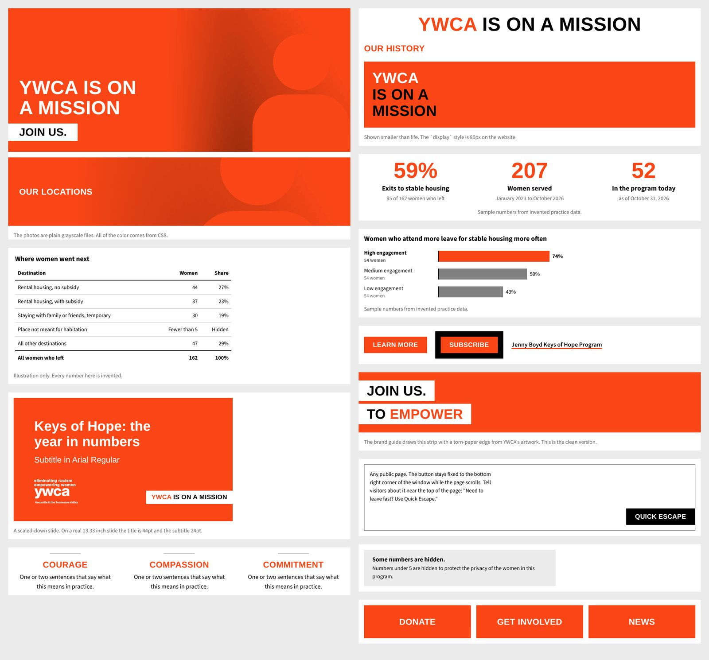

# YWCA Knoxville design kit

Colors, type, components, a Power BI theme, and writing rules for YWCA Knoxville & the Tennessee Valley, in plain files that people and AI assistants can both read.

> **Unofficial working draft.** Volunteers made this at Hack for Nonprofits 2026. YWCA has not reviewed it. Where this kit and YWCA staff disagree, YWCA staff are right.



## Use it with your AI assistant

1. Download [`YWCA-DESIGN-KIT.md`](YWCA-DESIGN-KIT.md). It is the whole kit in one file.
2. Give that file to your assistant at the start of a chat. Attach it, or paste its text in.
3. Ask for what you need: a chart title, a slide, a flyer, a funder summary.

It works in Claude, ChatGPT, Microsoft Copilot, Gemini, or any assistant that reads a file.

Starter prompts and a short checklist are in [`USE-WITH-AI.md`](USE-WITH-AI.md).

**Never paste resident names, records, or export files into an AI assistant.**

## What is inside

| Folder or file | What it is |
| --- | --- |
| [`YWCA-DESIGN-KIT.md`](YWCA-DESIGN-KIT.md) | The whole kit in one file, written for an AI assistant |
| [`USE-WITH-AI.md`](USE-WITH-AI.md) | How to use it, with prompts to copy |
| [`guides/`](guides) | Brand rules, voice and writing, Power BI, print and slides |
| [`tokens/`](tokens) | Colors, type, and spacing as JSON and as CSS variables |
| [`components/`](components) | 16 web components, each with a working preview and its rules |
| [`assets/logos/`](assets/logos) | The white logo and the persimmon logo |
| [`assets/power-bi/`](assets/power-bi) | A Power BI theme file |

## The rules in 30 seconds

- **Persimmon is the signal.** `#FA4616`. One bar, one number, one button. Everything else is black, white, or gray.
- **Persimmon text is big text.** 24px and up, or bold at 19px and up. Smaller text is black.
- **Square corners. No shadows.**
- **Say "YWCA", never "the YWCA".** Write "women", "participants", or "residents".
- **Words never cross a face** in a photo.
- **Counts under five are never shown.** Write "Fewer than 5".
- **Never show a resident's name, birth date, address, or photo.**

## For people who build things

- Web: link `tokens/tokens.css`, then copy the markup from any `components/<Name>/preview.html`.
- Power BI: import `assets/power-bi/ywca-knoxville-theme.json` from the View tab. Then read `guides/power-bi.md`.
- Coding agents: `AGENTS.md` points them at the one-file kit.
- After changing a guide, a token, or a component, rebuild the one-file kit:

  ```
  python3 scripts/build_kit.py
  ```

## What has and has not been checked

| | Status |
| --- | --- |
| Colors measured from ywca.org and ywcaknox.com | Done |
| Contrast checked against accessibility rules (WCAG 2.1 AA) | Done, for every pairing the kit allows |
| Component previews open and render | Done |
| Power BI theme imported in Power BI Desktop | Not yet |
| Reviewed by YWCA | Not yet |

## Who owns what

YWCA's name, logo, and brand belong to YWCA. See [`NOTICE.md`](NOTICE.md).

## Where it came from

The kit was made for the Keys of Hope dashboard project at Hack for Nonprofits 2026 (121 Tech Hub, Knoxville, November 19, 2026). Its sources are the 2018 YWCA USA brand guide, ywca.org, and ywcaknox.com. `guides/brand-rules.md` lists which part came from which source.

- The story of the day: https://abellminded.com/clients/ywca/keys-of-hope
- The dashboard and Power BI report: https://github.com/alex-abell/keys-of-hope-dashboard

Thank you to the team: Amy Shelton, Julianna Cutter, Bryan Terrill, Robert Ormand, and Alex Abell.
